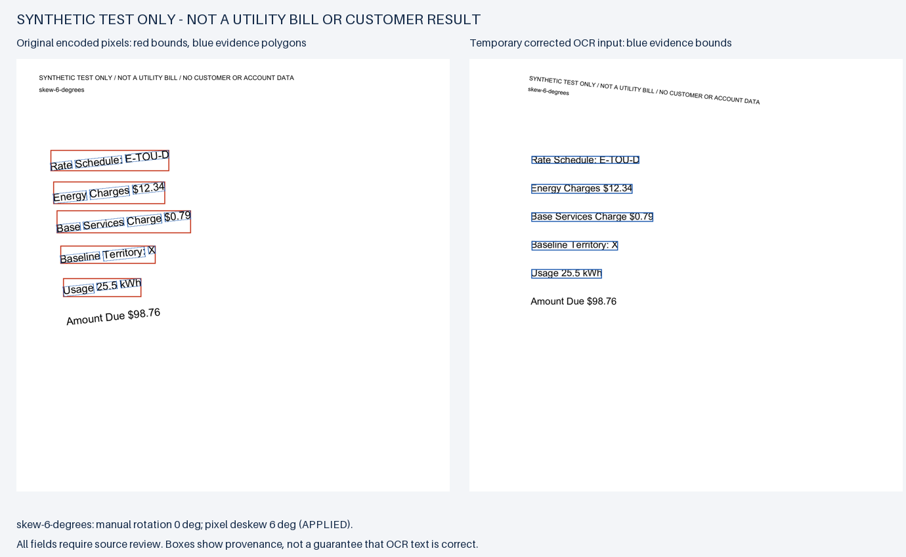
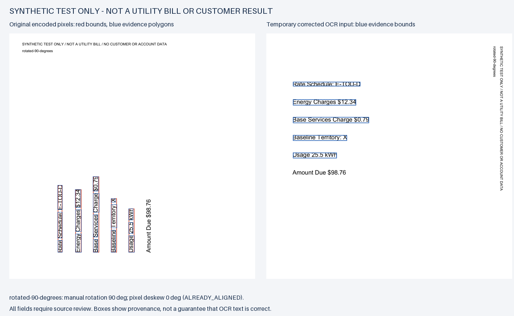

# Optional image preparation and original-source evidence

Observed October 31, 2026. Development runtime:
`fca8831c6c58441b5322eab7c52e20ee537f8a93`, based on the cancellation
branch at `147ff1d2583b2ea3921a50fe5b5b3a7c90b90189`. This is a draft
development change, not a release, tariff activation or customer validation.

## Problem and result

The unchanged eight-image development matrix reproduced **6/8 passing** before
this work. Six-degree skew lost the Base Services Charge; a quarter-turned body
lost all five supported fields. Optional local preparation and automatic page
layout now pass **8/8 on those same files and expectations**. One case uses an
operator-specified 90-degree clockwise correction. This is an assisted comparison,
not automatic orientation recognition or a blind holdout.

| Measure | Before | Final assisted path |
| --- | ---: | ---: |
| Entire image cases passing all checks | 6/8 | 8/8 |
| Expected valid candidates recovered | 32/38 | 38/38 |
| Missing expected candidates | 6 | 0 |
| Unexpected candidate values | 0 | 0 |
| Malformed comma, credit and unsupported-plan rejection cases | 3/3 | 3/3 |
| Conflicting charges retained without selecting/summing | 1/1 | 1/1 |
| Total measured extraction time for eight images | 2.146 s | 5.915 s |
| Manual orientation choices supplied | 0 | 1 |
| Returned values requiring confirmation | 32/32 | 38/38 |

Measurements use Tesseract 5.5.0 / Leptonica 1.86.0, Python 3.14.4 on Linux
through WSL, and Pillow 13.0.0 in an isolated optional environment. These single
runs do not estimate population accuracy or stable latency percentiles. Local
preparation adds time. Cloud/model calls are zero; actual dollar cost is unknown,
not recorded as a zero-cost claim. Human review time was not measured.

The first implementation still passed only 6/8. A long upright header dominated
whole-page deskew; single-block OCR joined a rotated header to otherwise correct
amounts. The final estimator takes a median of pixel-projection scores over
nonempty horizontal bands. The prepared path uses Tesseract automatic layout
without orientation detection (`--psm 3`), with **one OCR invocation**. It never
selects a transform based on extracted amounts or the number of matching fields.
Five of eight final images had an ambiguous small-angle estimate and received
**no deskew correction**, with a warning. The skewed body received +6 degrees;
the quarter-turn was supplied explicitly. All fields still require review.

## Source and derived-image boundary

- Original bytes stay unchanged. Extraction starts from an owned snapshot and
  rechecks the source and derived-image hashes before returning candidates.
- `ocr_rotation_degrees` is an optional clockwise angle in [-360, 360], applied
  after EXIF orientation; `ocr_deskew` is an optional boolean. Both default off.
  The ordinary PDF/image path does not import or require Pillow.
- A bounded child prepares a temporary PNG. Its metadata records image sizes,
  EXIF orientation, requested/estimated angles, estimator version, transform
  matrices and derived hash. A deskew score ratio is an uncalibrated geometric
  signal, not a correctness probability.
- Candidate and unresolved-field boxes map back to **original encoded pixels**,
  before a viewer applies EXIF display rotation. Word polygons, enclosing boxes,
  derived boxes/hash and any edge clipping are retained. A client must honor the
  coordinate-system label rather than overlaying them on an automatically
  rotated preview. A mapped region does not prove its OCR text is correct.
- PNG/JPEG/TIFF, RGB/grayscale (including alpha composited onto white), single
  page only for preparation. Multipage TIFF and preparation requested on PDF
  return explicit errors. Export an intended scanned PDF page as an image.
  EXIF orientations 1–8 are tested; TIFF's decoder-applied orientation is undone
  losslessly before the single encoded-pixel transform.
- Preparation has a 10-second child limit and shares the existing 30-second
  preparation/OCR budget. Source/derived files are limited to 25 MB; source and
  expanded canvases to 25 million pixels and 20,000 pixels per side. Metadata
  capture is 16 KB; OCR output remains bounded. These are not hard native RAM
  limits or an OS sandbox. The existing two-extraction SDK admission limit and
  cancellation/cleanup apply to the preparation child as well.

## Verification and retained failures

- Existing Windows optional-profile baseline: **124 passed**, 29.705 seconds.
- Twelve contracts committed before implementation: initially 2 failures and
  15 errors (including subtests); final unchanged contracts pass.
- Additional decoder/metadata tests exposed 13 failures and one overflow error,
  including TIFF double-orientation. A mixed-header deskew test and automatic
  layout contract then failed before their repair. All failure logs are retained.
- Final targeted image suite: **19 passed**, 8.029 seconds. Complete Windows
  optional-profile suite: **143 passed**, no skips, 37.110 seconds.
- Actual local CLI and SDK 2.3.0 stdio calls in `2026-07-28` and `legacy` modes
  pass with real Pillow/Tesseract. Each SDK connection rejects a malformed image
  with a redacted error, remains usable, then extracts both corrected images.
  This is real transport/parser verification, **not a new Hermes model run**.
- Linux CLI `scope` passes with site packages disabled. The equivalent Windows
  probe fails because Windows needs the documented `tzdata` dependency; the
  normal Windows environment passes. It is not counted as a platform-free pass.
- Both evidence overlays below were opened and visually inspected. Original
  boxes/polygons cover the cited source words; total amount due is not a candidate.
  No interactive product UI was changed and no independent human test occurred.





Receipts: [before](../reports/image-preparation-ocr-before-20261031.json),
[first implementation without improvement](../reports/image-preparation-ocr-after-20261031.json),
[final matrix](../reports/image-preparation-layout-ocr-after-20261031.json),
[CLI/SDK](../reports/image-preparation-client-20261031.json), and
[verification manifest](../reports/image-preparation-verification-20261031.json).
The original bill-input-v2 manifest hash is
`a1a17439f5ffaba5defce0c5de74085a3852165ff682872a8d62291c28fdb99f`.
The committed preparation profile records the manual intervention separately.

## Setup and reproduction

From this checkout, install optional image preparation and, if needed, the SDK:

```shell
python -m pip install -r plugins/billfit/requirements-image-input.txt
python -m pip install -r plugins/billfit/requirements-agent.txt
python plugins/billfit/skills/billfit/scripts/billfit_cli.py extract-bill --input-file plugins/billfit/skills/billfit/examples/synthetic-image-prepare.json
python -m unittest discover -s plugins/billfit/tests -v
python scripts/evaluate-bill-input-matrix.py --kind image --image-preparation --output /absolute/new-matrix.json
python scripts/verify-image-preparation-client.py --output /absolute/new-client-receipt.json
```

Set `BILLFIT_TESSERACT_PATH` in the CLI/host environment to an **existing trusted**
executable. A portable installation may also need its library and tessdata paths;
the scripts do not install it, send data to the cloud or load `.env` automatically.
The supplied example uses the committed synthetic quarter-turn, not a real bill.
Actual user paths must come unchanged from the user/client. Local processing does
not stop the host from sending returned values/snippets to its configured model.

On `IMAGE_DEPENDENCY_REQUIRED`, install the optional profile in the server's
interpreter. Invalid options, unsupported/multipage input, pixel/file/output limits,
timeouts and source changes remain explicit errors. Do not retry angles to obtain
a desired amount. Use visual inspection, a readable source copy or manually
verified fields when layout/legibility remains uncertain.

## Architecture references checked October 31

- [Tesseract image quality and page segmentation](https://tesseract-ocr.github.io/tessdoc/ImproveQuality.html):
  skew and inappropriate single-block assumptions can harm recognition.
- [Pillow 13 image transforms](https://pillow.readthedocs.io/en/stable/reference/Image.html)
  and [TIFF behavior](https://pillow.readthedocs.io/en/stable/handbook/image-file-formats.html#tiff):
  optional decoding/transforms, verified against installed 13.0.0 and actual pixels.
- [OCRmyPDF pipeline at b457e9e](https://github.com/ocrmypdf/OCRmyPDF/blob/b457e9efa68c3a46be2470ffb222ed1bccc4dcbc/src/ocrmypdf/_pipeline.py):
  orientation gating and a separate derived OCR image informed the separation
  of source, preparation and recognition. The pinned file blob was
  `6dea55e91db3944b875926f55b5c173542872bc6`.
  Its [MPL-2.0 license](https://github.com/ocrmypdf/OCRmyPDF/blob/b457e9efa68c3a46be2470ffb222ed1bccc4dcbc/LICENSE)
  was checked. No source was copied; OCRmyPDF/Ghostscript were not added as dependencies.

## Rollback and remaining work

No database, tariff snapshot or user-file migration is required. Stop supplying
the two optional arguments to restore the default extraction path. A whole-code
rollback can restore the prior reviewed branch/commit through an ordinary revert
or deployment checkout; do not rewrite history. Remove optional packages only
from an owned environment after checking its other users.

Remaining: native Windows Tesseract, permissioned customer bills, independent
holdout layouts (including multiple body orientations, tables, photos, perspective
distortion and non-English labels), and measured human review effort. No automatic
quarter-turn detector, scan-PDF rendering, perspective correction or client image
preview is promised. The eight samples were used during development; 8/8 does
not establish real-bill reliability. Existing tariff, eligibility, calculator and
human-confirmation gates remain unchanged. Tariff verification stays dated
October 27; this input milestone does not reverify it. Publishing remains separate.
