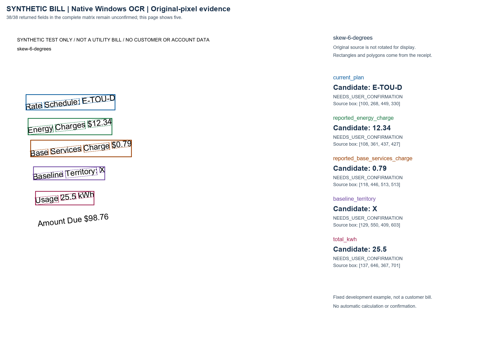
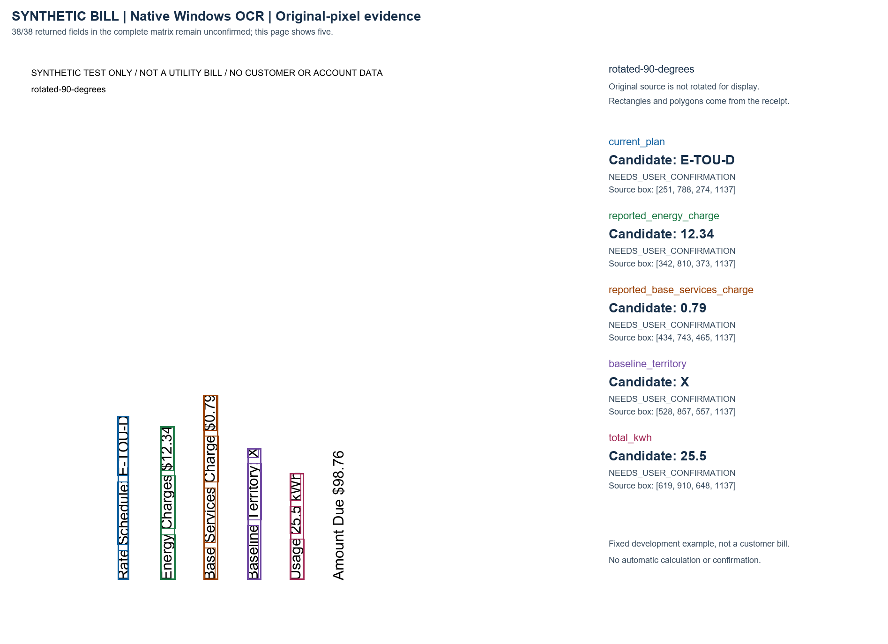

# Native Windows bill-image verification

Observed 1 November 2026, on the existing Windows workstation. This closes the
native-parser verification gap for one environment. It is not a clean-machine
installation test, customer-bill study or independent human trial.

## Change and frozen scope

The existing parser, image preparation and evidence mapping worked without a
product-code change. A verification script incorrectly described every platform
as Linux; its receipt now reports the actual platform. This milestone adds that
correction, Windows setup instructions, a frozen plan and reproducible evidence.
No calculation, tariff, assistance rule, dependency requirement, fixture, test
assertion or confirmation gate changed. The hosted application is unchanged.

Baseline: draft #12, `9e8f047bf46f0a7709e334705bfbfbbb21112b33`. The
[plan](../evaluations/windows-ocr-v1/plan.json) was committed at
`338cc36e7052cf9c3370505b5fe26ab9b342a822` before OCR execution. The subsequent
single-line receipt correction is `6113880`; all native observations follow it.
It changes the environment description, not success criteria.

## Matched native observations

Both arms use the same eight existing synthetic files, expected values and native
runtime. The prepared arm uses the existing profile, including one predeclared
90-degree clockwise correction. This is assisted, not automatic orientation detection.

| Fixed eight-image matrix | Default | Existing optional preparation |
| --- | ---: | ---: |
| Cases passing every field/evidence/rejection check | 6/8 | 8/8 |
| Expected candidates recovered | 31/38 | 38/38 |
| Missing expected candidates | 7 | 0 |
| Unexpected candidate values | 0 | 0 |
| Candidates requiring user confirmation | 31/31 | 38/38 |
| Sum of extraction time | 2.375 s | 6.777 s |
| Manual orientation choices | 0 | 1 |

Without preparation, six-degree skew loses the plan and base charge; a quarter-turn
loses all five fields. Preparation recovers them. Malformed commas, credits,
unsupported plans and conflicting charge candidates retain rejection/review
behavior. Total amount due is not treated as a supported comparable charge.

These one-shot observations share a workstation with other tests. They are not
population accuracy, stable latency or cost estimates. The earlier
[WSL observation](image-preparation-2026-10-31.md) used Tesseract 5.5.0, Leptonica
1.86.0 and Python 3.14.4, and returned 32 default-path candidates. It is preserved;
different engine/runtime versions prevent attributing the difference to Windows.

The actual local CLI passed on the skewed image. Real MCP SDK 2.3.0 stdio clients
passed both existing modes, `2026-07-28` and `legacy`: malformed-image rejection
with redacted errors, another scope request, then valid skew and quarter-turn
extraction on the same connection. The five successful CLI/SDK image results keep
source hashes, original-pixel polygons and `NEEDS_USER_CONFIRMATION`. Sources remain
unchanged and temporary request files are removed. No Hermes/model session ran.

A [separate path follow-up](../evaluations/windows-ocr-v1/path-followup.json),
frozen at `ac12279` before its three CLI requests, also passed: ASCII, spaces and
non-ASCII source/temporary directories. Each new process reads a byte-identical
copy of the skew fixture, preserves five unconfirmed candidates and removes its
parser temporary files. No user file is substituted. This covers those three
paths, not every long path, UNC share or filesystem policy; it is separate from
the eight-image quality denominator.

The complete Windows optional-profile suite passed **200 tests, zero skips,
47.945 seconds**. Existing tests are unchanged. Hosted Linux checks are reported
separately for the delivery commit; they do not execute this native runtime.

## Visual evidence

Both overlays were opened and checked against the original synthetic text. Word
polygons and boxes cover the cited labels/values, including the quarter-turned
original. These are verification figures, not a new product UI or human study.





[Verification and retained outputs](../reports/native-windows-ocr-2026-11-01/verification.json)
bind the plan, code, runtime, language data, source images, both arms, CLI/SDK
observations and regression log. Public artifacts redact local path prefixes and
retain original hashes. The unsuccessful default arm remains a failed observation.

## Runtime provenance and signing limit

The [upstream download documentation](https://tesseract-ocr.github.io/tessdoc/Downloads.html)
points Windows users to community builds. The
[UB Mannheim page](https://github.com/UB-Mannheim/tesseract/wiki) links the same
asset on the [upstream 5.5.3 release](https://github.com/tesseract-ocr/tesseract/releases/tag/5.5.3).
These sources were checked on 1 November 2026; this is a selected pinned build,
not a claim about all latest versions or packages.

- Asset: `tesseract-ocr-w64-setup-5.5.3.20260724.exe`, 26,573,224 bytes. Its download
  matches the release API's SHA-256:
  `bee9e3434bd94fd65387d9be28cd467a41f61b1275383b55b0f59a1331270ae4`.
- Existing 7-Zip 21.07 extracted selected executable/DLL/config/license files into
  a new workspace directory. The installer was never executed. No registry or
  global PATH installation occurred. Runtime and language-data hashes were checked
  before execution. Binaries remain outside Git.
- Native version: Tesseract `5.5.3.20260724`, Leptonica `1.87.0`, Python `3.11.3`,
  Pillow `13.0.0`, MCP `2.3.0`. The separately acquired
  [official English fast data](https://github.com/tesseract-ocr/tessdata_fast/tree/87416418657359cb625c412a48b6e1d6d41c29bd)
  is pinned and verified against its Git blob and SHA-256. Tesseract and this data
  use Apache-2.0. No third-party binary is redistributed.
- **Windows Authenticode did not pass.** The result was `UnknownError` with a
  certificate time-validity error. Observed publisher: Universitaet Mannheim;
  signer expiry: 9 December 2023; a 2026 timestamp certificate was reported.
  The original observation is retained. No certificate, clock or trust policy
  changed. This local experiment used the independently verified upstream asset
  digest as its acquisition basis.

Functional parsing and verified download bytes do not establish valid publisher
signing or installer acceptance. An organization requiring valid signing still
needs an acceptable runtime before rollout. This does not clear that gate or the
separate JobFlow signing blocker.

## Reproduce with an operator-approved runtime

Use an existing trusted Windows installation. These are placeholder installation
paths, not a downloader; set variables in the CLI/MCP host's launching shell:

```powershell
$env:BILLFIT_TESSERACT_PATH = 'C:\Tools\Tesseract-OCR\tesseract.exe'
$env:TESSDATA_PREFIX = 'C:\Tools\Tesseract-OCR\tessdata'
python -m pip install -r plugins/billfit/requirements-agent.txt -r plugins/billfit/requirements-image-input.txt
python scripts/evaluate-bill-input-matrix.py --kind image --output native-default.json
python scripts/evaluate-bill-input-matrix.py --kind image --image-preparation --output native-prepared.json
python scripts/verify-image-preparation-client.py --output native-client.json
python scripts/verify-native-windows-paths.py --output native-paths.json
python -m unittest discover -s plugins/billfit/tests -v
```

The language directory contains `eng.traineddata` and `configs/tsv`. A regular
installation may find it automatically; a portable one can require the explicit
`TESSDATA_PREFIX`. `.env.example` is documentation and is not auto-loaded.
Use new output files. The default matrix returns nonzero for its two failed cases;
do not label it passed or retry angles to obtain expected values.

No cloud fallback or paid provider is activated. Hardware, energy and operator
cost remain unmeasured. Review every candidate against its source before supplying
it to deterministic calculation. This milestone does not reverify rate data.

## Adoption, rollback and open work

No database, source-data, tariff or dependency migration is required. Product
runtime files are unchanged. Stop owned OCR work before changing its configured
executable or language data. Retain evidence and sources; do not run the downloaded
installer's uninstaller against the workspace. Reverting the receipt correction
restores an inaccurate Linux-only description, not different parser behavior.

Remaining: an accepted signed distribution where required, clean-machine setup,
permissioned customer bills, independent layouts, photos/perspective distortion,
non-English labels and measured reviewer effort. Native execution here does not
complete those requirements. Publication/deployment still needs separate approval.
